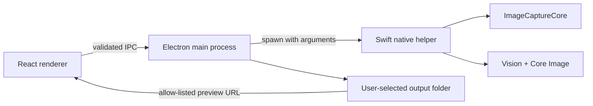

# Architecture

Keepsake Scanner combines an Electron interface with a native Swift helper so the app can use macOS scanner and image-processing frameworks directly.

## Renderer

`src/` contains the React interface, translations, demo bridge, preview canvas, metadata editor, and scan controls. The renderer has no Node.js integration and cannot call Electron APIs directly.

## Preload bridge

`electron/preload.cjs` exposes a narrow API through `contextBridge`. Each operation maps to an explicit IPC channel.

## Main process

`electron/main.cjs` owns:

- application settings and the global scan counter
- native helper process execution
- output folder validation and atomic numbering
- file dialogs and Trash operations
- an allow-listed custom protocol for image previews
- renderer navigation and permission policy

Settings live in Electron’s per-user application data directory. Scans default to a folder inside the current macOS Pictures directory.

## Native helper

`native/Sources/PhotoScannerNative/main.swift` provides:

- scanner discovery and flatbed acquisition through ImageCaptureCore
- rectangle detection through Vision and a light-background fallback
- perspective correction through Core Image
- face-first and text-fallback orientation analysis on downsampled images
- full-resolution JPEG output
- lossless EXIF/XMP metadata updates when possible
- photo rotation
- a deterministic synthetic-fixture self-test

The helper emits newline-delimited JSON to stdout and structured errors to stderr.

## Data flow

1. The renderer submits validated scan settings.
2. The main process creates a temporary session directory.
3. The native helper scans or reads a flatbed image.
4. The helper detects and writes temporary crops.
5. The main process copies crops to the selected folder with exclusive file creation.
6. The global counter is updated atomically.
7. Only output and active source paths are approved for renderer previews.
8. Temporary session files are deleted when the application quits.
